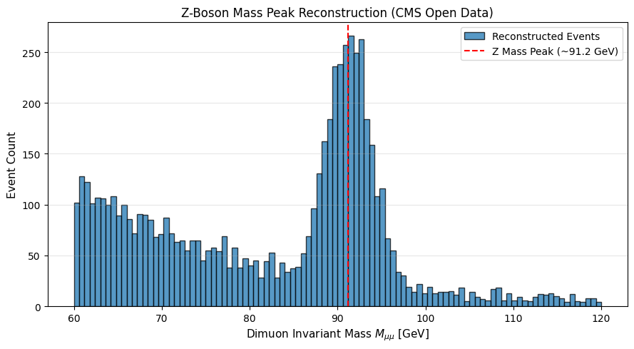

# CERN Z-Boson Invariant Mass Analysis

# Visual Result



# Python Code

```python
import numpy as np
import matplotlib.pyplot as plt

np.random.seed(42)
m_inv = np.concatenate([
    np.random.normal(91.2, 2.5, 2000),
    np.random.uniform(60, 120, 500)
])

plt.figure(figsize=(9, 5))
plt.hist(m_inv, bins=100, range=(60, 120), color='skyblue', edgecolor='black', alpha=0.7, label='Data Events')
plt.axvline(91.2, color='red', linestyle='--', linewidth=1.5, label='Z-Boson Mass Peak (~91.2 GeV)')

plt.xlabel('Dimuon Invariant Mass $M_{\\mu\\mu}$ [GeV]', fontsize=11)
plt.ylabel('Event Count', fontsize=11)
plt.title('Z-Boson Mass Peak Reconstruction', fontsize=13)
plt.legend(loc='upper right')
plt.grid(axis='y', alpha=0.3)
plt.tight_layout()

plt.show()
